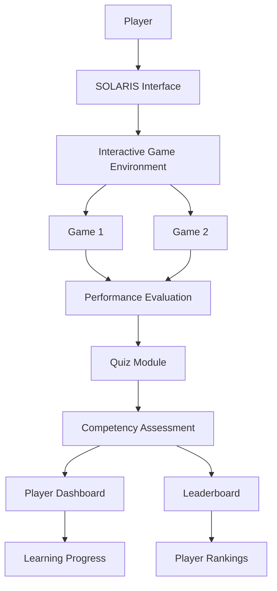

<div align="center">

  

  # 🚀 SOLARIS: A SPACE DREAM

  ### Interactive 3D Space Mission Design & Exploration Game

  **NASA Space Apps Challenge 2026** • Space Exploration • Gaming • STEM Education • Interactive Learning

  
  
  
  

  **From Screen Time to Space Time, Less Scrolling More Exploring.**

</div>

---

## 🚀 NASA Space Apps Challenge 2026

| **Details** | **Information** |
|---|---|
| Project Name | SOLARIS: A Space Dream |
| Challenge | NASA Space Apps Challenge 2026 |
| Project Category | Space Mission Design Game |
| Project Type | Interactive 3D Game |
| Team Name | Teen Titans Og |
| Team | Gargi Narooka (Team Owner), Chandni Varyani (Team Member) |
| Core Experience | Space Mission Design, Games, Quizzes & Leaderboard |

---
# 🌌 1. Executive Summary

**SOLARIS: A Space Dream** is an interactive 3D space exploration and mission-design game developed for the NASA Space Apps Challenge 2026.

SOLARIS transforms the fascinating yet complex world of space exploration into an engaging gaming and learning experience. It invites players to explore space science through interactive games, quizzes and competency-based competition.

Instead of simply watching space missions unfold, players become active participants in a space-themed digital environment. Through gameplay, they explore scientific concepts, solve challenges, test their knowledge and track their progress through a leaderboard.

Built using **Python and Panda3D**, with **Blender** supporting 3D modelling, SOLARIS brings together game development, scientific exploration, interactive learning and digital creativity.

Our larger vision is to make digital engagement more meaningful by encouraging people of different ages to explore, learn, create and discover.


---

# 🎯 2. Problem Statement

Space exploration has always fascinated humanity. However, understanding the science, engineering and decision-making behind actual space missions can be difficult for beginners.

Traditional educational approaches often focus on theoretical explanations, leaving limited opportunities for learners to interact with scientific concepts, experiment and experience the challenges of space exploration.

At the same time, digital engagement increasingly involves passive content consumption, endless scrolling and rapidly consumed entertainment.

There is an opportunity to make screen-based experiences more meaningful by combining entertainment with active learning.

### Key Problems

- Complex space science concepts can be difficult for beginners to understand.
- Traditional learning often lacks interactive experimentation.
- Learners have limited opportunities to experience space-related challenges through gameplay.
- Educational content does not always provide engaging feedback and measurable learning progress.
- Digital entertainment can encourage passive consumption rather than active participation.

### Our Central Question

**What if people could experience space exploration instead of simply watching it?**

---

# ⚠️ 3. Why Current Practices Are Not Enough

| Current Approach | Gap |
|---|---|
| Traditional educational content | Often relies on theoretical explanations |
| Space documentaries and videos | Primarily offer passive viewing experiences |
| Conventional gaming | Entertainment may not include structured learning assessment |
| Online quizzes | Assess knowledge but may lack experiential context |
| Educational applications | May not combine interactive gaming and competitive assessment |

SOLARIS aims to bridge these gaps by bringing interactive gameplay, knowledge assessment and competency-based competition into one experience.

---

# 💡 4. Our Proposed Solution

SOLARIS is an interactive space-themed gaming platform designed to make space science approachable, engaging and enjoyable.

It combines four core elements:

| Pillar | Function |
|---|---|
| EXPLORE | Discover space science and exploration concepts |
| PLAY | Participate in two interactive space-themed games |
| LEARN | Test and reinforce knowledge through quizzes |
| COMPETE | Track achievements and competencies through a leaderboard |

Through this approach, SOLARIS turns learning into an experience rather than an obligation.

---

# ✨ 5. Key Features

### 🪐 Interactive Space Environment
An engaging 3D environment that introduces players to the world of space exploration.

### 🎮 Two Interactive Games
Two space-themed games that encourage players to apply concepts through challenges, strategic thinking and problem-solving.

### 🧠 Integrated Quizzes
Interactive knowledge assessments that reinforce learning and test players' understanding.

### 🏆 Competency-Based Leaderboard
A competitive ranking system that recognises player performance, knowledge and achievements.

### 📊 Player Dashboard
A centralised interface for accessing player information, performance and learning progress.

### 🔄 Replay and Improvement
Players can revisit games and quizzes to improve their performance.

### 🌍 Inclusive Learning Experience
Designed to make space exploration approachable for children, students, casual gamers and adults.

---

# 🎮 6. How SOLARIS Works

SOLARIS follows an interactive learning workflow:

**EXPLORE → PLAY → QUIZ → EVALUATE → COMPETE → IMPROVE**

1. **Enter the SOLARIS Universe:** Players enter the interactive space-themed environment.
2. **Explore:** Discover space-related concepts and the learning environment.
3. **Play Game 1:** Participate in the first interactive space-themed challenge.
4. **Play Game 2:** Take on another challenge involving space concepts and problem-solving.
5. **Attempt the Quiz:** Test knowledge through interactive questions.
6. **Evaluate:** Assess performance and learning outcomes.
7. **Check the Leaderboard:** Compare rankings and achievements.
8. **Improve:** Revisit games and quizzes to strengthen knowledge and improve scores.

This workflow combines entertainment, learning and measurable performance.

---

# 🏗️ 7. System Architecture

SOLARIS follows a modular architecture connecting its interactive environment, gameplay, quizzes and performance assessment.

### High-Level Architecture



### Main System Components

| Component | Responsibility |
|---|---|
| User Interface | Player interaction and navigation |
| Game Environment | Interactive space experience |
| Game Modules | Two space-themed games |
| Quiz Module | Knowledge assessment |
| Evaluation Module | Competency and performance assessment |
| Dashboard | Player progress and performance |
| Leaderboard | Comparative player rankings |

### Architecture Diagram


---

# 🧩 8. Technical Design and CAD Model

SOLARIS uses 3D modelling and interactive game development to create its space exploration experience.

**3D Modelling Software: Blender**

Blender is used for creating and preparing 3D visual assets and models for the project.

### CAD / 3D Model


### Technical Design Documentation

- 3D model and visual design.
- System architecture.
- Gameplay workflow.
- Interface and interaction design.
- Component and module relationships.
- Technical implementation.

### Design Assets

| Asset | Repository Location |
|---|---|
| SOLARIS Logo | `assets/solaris-logo.png` |
| CAD Model | `assets/cad-model.png` |
| Architecture Diagram | `docs/architecture.png` |
| Technical Design | `docs/technical-design.png` |
| Workflow Diagram | `docs/workflow.png` |
| UI/UX Screenshots | `assets/screenshots/` |

---

# 📊 9. Dashboard and Monitoring

The SOLARIS dashboard provides a centralised view of the player's learning and gaming experience.

### Dashboard Highlights

- Player performance overview.
- Game achievements.
- Quiz scores and results.
- Competency assessment.
- Leaderboard rankings.
- Learning progress.


---

# 🤖 10. AI and ML Intelligence

AI tools supported different stages of the SOLARIS development process.

### AI Tools Used

| AI Tool | Contribution |
|---|---|
| ChatGPT | Brainstorming, research assistance and documentation |
| Claude | Development assistance and problem-solving |
| Google Gemini | Technical research and idea exploration |
| GitHub Copilot | Code suggestions and completion |
| Nano Banana | AI-assisted image generation and visual assets |

**AI Disclosure:** These tools supported the development process. They are not being represented as integrated AI/ML gameplay systems. The project concept, design decisions, development and implementation were driven by our team.

---

# 🛰️ 11. NASA Data and Research Resources

NASA resources and scientific references helped inform the space exploration and mission-design concepts used in SOLARIS.

### NASA Resources

| Resource | Reference |
|---|---|
| NASA General Mission Analysis Tool (GMAT) | Orbital mechanics and mission analysis |
| NASA Mission Design Lab | Space mission planning |
| NASA Concept Maturity Levels (CML) | Mission concept development |
| NASA Mission Viz | Orbital and mission visualisation |
| NASA CubeSat 101 Handbook | CubeSat systems and design |
| Orrery and Orbital Parameters Table | Orbital information |
| Earth-Moon Mission Visualization | Earth-Moon mission concepts |
| 3D Elliptical Orbit Design | Elliptical orbital paths |
| Orrery with Potentially Hazardous Asteroids | Asteroid orbit visualisation |
| Ontology-Based Orrery | Celestial object relationships |

### Space Agency Partner Resource

**Canadian Space Agency (CSA) – Digital Games and Activities**

https://www.asc-csa.gc.ca/eng/youth-educators/digital-games-and-activities.asp

Referred to as an educational resource for interactive space-learning experiences and approaches to making space science accessible to learners.

*The resources listed above are research references unless explicitly identified as integrated into the application.*

---

# 🛠️ 12. Technology Stack

SOLARIS combines Python-based game development, 3D modelling, version control and deployment technologies.

### Core Development Stack

| Category | Technology | Purpose |
|---|---|---|
| Programming Language | Python | Primary programming language |
| 3D Game Engine | Panda3D | Interactive 3D game development |
| 3D Modelling | Blender | 3D modelling and visual asset creation |
| Version Control | Git | Source code version management |
| Repository Hosting | GitHub | Code hosting and collaboration |
| Deployment Platform | Vercel | Planned deployment platform |

### AI-Assisted Development Tools

| Tool | Purpose |
|---|---|
| ChatGPT | Ideation, research and documentation |
| Claude | Development assistance |
| Google Gemini | Technical research |
| GitHub Copilot | Code completion and assistance |
| Nano Banana | AI-assisted visual generation |

### Official Technology Resources

- [Python](https://www.python.org/)
- [Panda3D](https://www.panda3d.org/)
- [Blender](https://www.blender.org/)
- [Git](https://git-scm.com/)
- [GitHub](https://github.com/)
- [Vercel](https://vercel.com/)

---

# 📈 13. Impact and Sustainability

SOLARIS aims to create value beyond entertainment.

### Educational Impact
Makes space science and exploration more accessible through interactive experiences.

### Cognitive Engagement
Encourages logical reasoning, concentration, creativity and problem-solving.

### Digital Well-being
Promotes purposeful screen engagement rather than passive digital consumption.

### Inclusive Learning
Creates an experience that can engage children, students, casual gamers and adults.

### Long-Term Sustainability
Its modular structure offers opportunities to expand the platform with new games, quizzes, missions and educational challenges.

### Our Larger Vision

We want to transform how people engage with digital entertainment.

Not simply by reducing screen time, but by making the time spent on screens more meaningful.

**FROM SCREEN TIME TO SPACE TIME. LESS SCROLLING. MORE EXPLORING.**

---

# 🗺️ 14. Development Roadmap

| Phase | Development Focus |
|---|---|
| Phase 1 | Project concept and interactive environment |
| Phase 2 | 3D modelling and game development |
| Phase 3 | Two interactive games |
| Phase 4 | Quiz and competency-based leaderboard |
| Phase 5 | Dashboard and performance experience |
| Phase 6 | Testing, optimisation and deployment |
| Phase 7 | Additional missions and expanded learning experiences |

*Update the roadmap to distinguish completed, ongoing and planned development.*

### Future Scope

- More space exploration games.
- Additional planetary and lunar missions.
- Advanced orbital and spacecraft simulations.
- Expanded multiplayer and collaborative gameplay.
- More detailed performance analytics.
- Improved accessibility and language support.
- Integration of relevant real-world space datasets.
- Community challenges and global competitions.

---

# 📁 15. Repository Structure

```text
solaris-space-mission-game/
│
├── README.md
│
├── assets/
│   ├── solaris-logo.png
│   ├── cad-model.png
│   │
│   └── screenshots/
│       ├── home.png
│       ├── game-1.png
│       ├── game-2.png
│       ├── quiz.png
│       ├── dashboard.png
│       └── leaderboard.png
│
├── docs/
│   ├── architecture.png
│   ├── technical-design.png
│   ├── workflow.png
│   └── project-documentation.md
│
├── src/
│   └── [application source code]
│
├── requirements.txt
├── .gitignore
└── LICENSE
```

---

# 💻 16. Run SOLARIS Locally

### Prerequisites

- Python (use the version required by the project).
- Git.
- Panda3D.
- Required project dependencies.

### Step 1: Clone the Repository

```bash
git clone https://github.com/CHANDNI-VARYANI/solaris-space-mission-game.git
```

### Step 2: Navigate to the Project

```bash
cd solaris-space-mission-game
```

### Step 3: Create a Virtual Environment

```bash
python -m venv venv
```

Activate the environment.

**macOS / Linux**

```bash
source venv/bin/activate
```

**Windows**

```bash
venv\Scripts\activate
```

### Step 4: Install Dependencies

```bash
pip install -r requirements.txt
```

### Step 5: Run the Game

```bash
python main.py
```

*Replace `main.py` with the actual application entry-point filename if different.*

---

# 🌐 17. Deployment

SOLARIS is being prepared for public deployment.

### Planned Deployment Platform

**Vercel**

https://vercel.com/

### Deployment Workflow

1. Prepare the production build.
2. Verify application dependencies.
3. Configure the deployment environment.
4. Connect the appropriate project files to the hosting platform.
5. Configure required environment variables, if applicable.
6. Deploy and test the application.
7. Publish the live application link.

### Live Application

**Deployment status:** In progress.

**Live URL:** To be added after successful deployment.

**Technical deployment note:** Panda3D is a Python-based 3D game engine. Vercel is not a direct replacement for a desktop Panda3D runtime. The deployment architecture must support the actual application build, potentially through a browser-compatible frontend or a separately hosted game runtime. This needs to be verified before publishing a live deployment claim.

---

# 🎥 18. Screenshots and Gameplay Demonstration

### Explore SOLARIS

| Section | Screenshot |
|---|---|
| Main Interface | `assets/screenshots/home.png` |
| Interactive Game 1 | `assets/screenshots/game-1.png` |
| Interactive Game 2 | `assets/screenshots/game-2.png` |
| Quiz Module | `assets/screenshots/quiz.png` |
| Dashboard | `assets/screenshots/dashboard.png` |
| Leaderboard | `assets/screenshots/leaderboard.png` |

### Project Demonstration Video

**Watch SOLARIS in Action:** [Insert public demo video URL]

---

# 🌟 19. Market Positioning

SOLARIS operates at the intersection of:

- Educational Gaming.
- Space Science and Exploration.
- STEM Learning.
- Interactive 3D Experiences.
- Gamified Knowledge Assessment.
- Digital Creativity and Engagement.

SOLARIS combines space-themed gaming with quizzes and competency-based assessment, creating an experience that goes beyond conventional educational content.

Its intended audience includes children, school and college students, casual gamers, adults, educators and space enthusiasts.

Our ambition is to make purposeful digital engagement enjoyable and accessible across age groups.

---
## 🎥 Live App

Experience **BeltCare** in action through our interactive App prototype.

🔗 **Prototype:

---


## 🎬 Project Pitch

Watch our complete project presentation to understand the problem, solution, architecture, and vision behind **BeltCare**.

▶️ ** Solaris Demonstration :

---


<div align="center">
Team Teen Titans

Building innovative AI solutions for real-world industrial challenges.

⭐ If you found this project interesting, consider giving this repository a Star!

**Made with ❤️ by Team Teen Titans Og**

</div>


---


<div align="center">

# 🚀 SOLARIS: A SPACE DREAM

*NASA Space Apps Challenge 2026*

</div>
