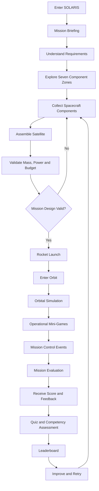
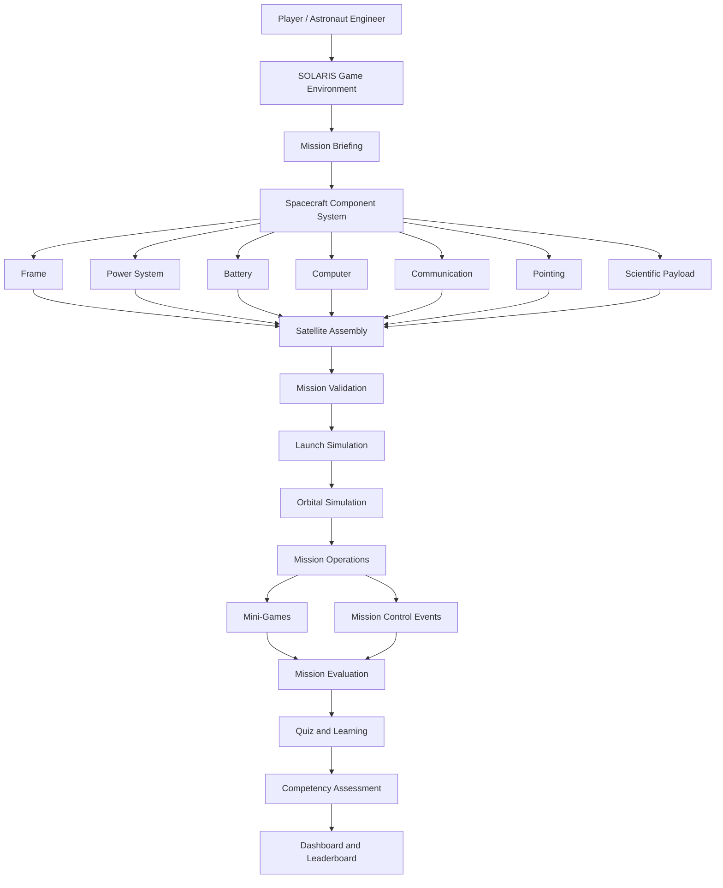

<div align="center">

  

  # 🚀 SOLARIS: A SPACE DREAM

  ### Interactive 3D Space Mission Design & Exploration Game

  **NASA Space Apps Challenge 2026** • Space Exploration • Gaming • STEM Education • Interactive Learning

  
  
  
  

  **From Screen Time to Space Time, Less Scrolling More Exploring.**

</div>

---

## 🚀 NASA Space Apps Challenge 2026

| **Details** | **Information** |
|---|---|
| Project Name | SOLARIS: A Space Dream |
| Challenge | NASA Space Apps Challenge 2026 |
| Project Category | Space Mission Design Game |
| Project Type | Interactive 3D Game |
| Team Name | Teen Titans Og |
| Team | Gargi Narooka (Team Owner), Chandni Varyani (Team Member) |
| Core Experience | Space Mission Design, Games, Quizzes & Leaderboard |

---

# 🌌 01. EXECUTIVE SUMMARY

**SOLARIS: A Space Dream** is an interactive 3D game that allows players to experience the complete journey of designing, building, launching and operating a space mission.

Players step into the role of blocky astronaut-engineers at a launch site, where every mission begins with a real-world-inspired objective and a set of engineering constraints.

From selecting spacecraft components and assembling satellites to managing orbital operations, players experience the decisions that shape the success or failure of a space mission.

SOLARIS introduces the interconnected nature of systems engineering through practical gameplay. Every component comes with trade-offs involving mass, power, budget, communications, data and time. Players must balance these resources, make engineering decisions, respond to unexpected mission events and improve their spacecraft through repeated experimentation.

With interactive mission challenges, operational mini-games, quizzes, difficulty modes, collaborative gameplay and a competency-based leaderboard, SOLARIS transforms complex space science into an engaging experience.

Our vision is to make space exploration accessible to everyone and turn passive digital consumption into meaningful discovery.

**From Screen Time to Space Time. Less Scrolling. More Exploring.**

---

# 🎯 02. THE PROBLEM STATEMENT

Space exploration fascinates millions, yet understanding how a real space mission is designed, built, launched and operated remains challenging for beginners.

A successful space mission involves several interconnected systems and engineering decisions. A spacecraft must satisfy requirements related to mass, power, battery capacity, payload, communications, orbital mechanics, launch compatibility, budget and mission duration.

These decisions cannot be understood in isolation.

For example:
- A more powerful scientific instrument may improve mission output but increase mass and power consumption.
- A larger battery may protect a spacecraft during an eclipse but increase its weight and cost.
- A communication system must balance data generation, transmission time and available ground-station contact.
- An incorrect orbital manoeuvre can consume valuable fuel and affect mission objectives.

Traditional learning often explains these concepts separately, without allowing learners to experiment with the consequences of their decisions.

At the same time, much of today's digital engagement revolves around passive content consumption rather than active exploration.

### The Problem We Address

**How can we make real space mission design understandable, interactive and accessible while transforming passive screen engagement into meaningful learning?**

---

# ⚠️ 03. WHY CURRENT PRACTICES ARE NOT ENOUGH

| Current Approach | Limitation |
|---|---|
| Textbooks and theoretical learning | Limited opportunities for practical experimentation |
| Space documentaries and videos | Primarily passive viewing experiences |
| Conventional educational games | May simplify concepts without demonstrating interconnected engineering trade-offs |
| Standalone quizzes | Test knowledge but may not provide practical mission experience |
| Advanced engineering simulators | Can be intimidating for beginners without technical backgrounds |

SOLARIS bridges the gap between theoretical learning and practical mission experience through interactive, mission-based gameplay.

---

# 💡 04. OUR PROPOSED SOLUTION

SOLARIS transforms spacecraft engineering and space mission operations into an interactive 3D gaming experience.

Players receive mission objectives, explore spacecraft components, assemble satellites, launch rockets, operate spacecraft in orbit and respond to real-world-inspired operational challenges.

Every engineering decision has consequences.

The game encourages players to experiment with different spacecraft configurations, understand resource constraints, learn from failures and improve their designs.

### Our Core Experience

| Stage | Experience |
|---|---|
| BRIEF | Understand mission objectives and constraints |
| COLLECT | Explore and select spacecraft components |
| BUILD | Assemble the satellite |
| LAUNCH | Test launch compatibility and fuel management |
| ORBIT | Observe orbital behaviour and spacecraft operations |
| OPERATE | Complete mission operations challenges |
| EVALUATE | Understand mission performance and improve designs |

**SOLARIS is not simply about reaching space. It is about understanding everything that makes a space mission possible.**

---

# ✨ 05. KEY FEATURES

## 🛰️ 5.1 Mission Briefing

Every mission begins with a specific objective and a set of requirements.

Example:

*Build a CubeSat to monitor crop health over India with a budget below $380,000 and a mass limit of 4 kg.*

Mission requirements may include:

- Spacecraft frame class.
- Maximum mass.
- Budget.
- Scientific payload.
- Radio and communication requirements.
- Pointing requirements.

## 🔧 5.2 Seven Spacecraft Component Zones

Players explore seven colour-coded zones to collect the components needed to build their satellite.

| Zone | Spacecraft Subsystem |
|---|---|
| 1 | Frame / Structure |
| 2 | Solar Panels |
| 3 | Battery |
| 4 | Onboard Computer |
| 5 | Radio / Communications |
| 6 | Pointing / Attitude Control |
| 7 | Scientific Payload |

Players select components, fill their hotbar and assemble their spacecraft block by block at the launch pad.

## 📊 5.3 Real-Time Engineering Trade-Offs

Every component influences multiple spacecraft parameters.

The game provides live indicators for:

- Total spacecraft mass.
- Mission cost.
- Solar power generation versus load.
- Battery capacity versus eclipse requirements.

A better camera may provide more scientific value but also increase mass, power consumption and data generation.

A larger battery may improve eclipse survival but increase spacecraft weight and budget.

There is rarely just one correct spacecraft design. Multiple configurations can succeed depending on how well players balance mission requirements.

## 🚀 5.4 Rocket Launch Simulation

Players launch their assembled spacecraft and experience the importance of launch compatibility.

Key gameplay elements include:

- Spacecraft mass validation.
- Launch vehicle compatibility.
- Rocket ascent controls.
- Fuel management.
- Launch success or failure.

An overweight spacecraft may fail to lift, while skill-based ascent controls influence the fuel remaining after launch.

## 🌍 5.5 Orbital Simulation

After launch, players observe their spacecraft orbiting Earth.

The simulation introduces concepts such as:

- Orbital period.
- Orbit altitude.
- Earth eclipses.
- Solar power availability.
- Battery requirements.
- Orbital mission operations.

If the spacecraft enters Earth's shadow without sufficient power or battery capacity, its operations can be compromised.

## 🎮 5.6 Four Operational Mini-Games

### 1. Downlink Rush

Assign ground-station antennas to satellite passes to ensure that generated scientific data is successfully transmitted.

**Concepts:** Data generation, communication windows, downlink time and link quality.

### 2. Eclipse Energy

Schedule instruments and heaters so the spacecraft battery can survive periods when the satellite enters Earth's shadow.

**Concepts:** Battery sizing, power budgets, energy consumption and depth of discharge.

### 3. Mission Sequencer

Arrange command blocks to plan one orbital cycle, then observe the simulation identify mistakes in the planned sequence.

**Concepts:** Mission planning, command sequencing and operational decision-making.

### 4. Orbit Burn

Plan orbital manoeuvres to reach a target orbit while working with limited fuel.

**Concepts:** Delta-v, orbital transfers, fuel limitations and mission lifetime.

## ⚡ 5.7 Mission Control Live

Unexpected events challenge players to make quick operational decisions.

Potential events include:

- Solar flare.
- Reaction-wheel failure.
- Ground-station outage.
- Budget cut.

Players must adapt their mission strategies and manage available resources.

## ⭐ 5.8 Mission Evaluation and Feedback

Every mission receives a performance evaluation of 0–3 stars.

Players receive:

- Mission performance score.
- A specific explanation of success or failure.
- Numerical feedback based on mission constraints.
- Comparison with similar real-world missions.
- A fix-and-retry opportunity.

Example:

*During Earth's shadow, the spacecraft requires approximately 16 Wh of battery capacity. Your design provides only 10 Wh.*

Instead of simply displaying an error, SOLARIS explains what went wrong and allows players to correct their design.

---

# 🧠 06. LEARNING THROUGH GAMEPLAY

SOLARIS follows the principle of learning by doing.

Failure is not treated as the end of a mission. It is an opportunity to understand engineering decisions and improve.

### 6.1 Learning by Failure

When a mission fails, players receive a specific explanation of the problem, supported by numerical feedback.

They can modify their spacecraft and immediately retry the mission.

This encourages experimentation and iterative problem-solving.

### 6.2 Concepts Learned at Every Stage

| Gameplay Stage | Concepts Learned |
|---|---|
| Collecting Parts | Spacecraft subsystems, mass, power and cost |
| Satellite Building | Mass budget, power budget, cost budget and engineering margins |
| Eclipse and Orbit | Orbital period, eclipse duration, solar panels and battery sizing |
| Launch | Payload capacity and rocket equation |
| Radio and Data Games | Data generation, downlink time and ground-station contact windows |
| Pointing | Attitude control and scientific instrument alignment |
| Orbit Burn | Delta-v, orbital transfers and fuel management |
| Mission Control Live | Risk, redundancy and decision-making under pressure |

### 6.3 Contextual Learning

Scientific concepts appear when players actually need them.

A short glossary and contextual explanations introduce terms such as:

- Eclipse.
- Delta-v.
- Link budget.
- Depth of discharge.
- Orbital period.
- Attitude control.

Players are not expected to have prior technical knowledge.

### 6.4 Two Difficulty Modes

**Explorer Mode**
- Guided learning.
- Helpful hints.
- More generous engineering margins.
- Beginner-friendly challenges.

**Mission Director Mode**
- Tighter engineering constraints.
- Unexpected operational events.
- Advanced decision-making.
- More challenging mission requirements.

---

# 👥 07. COLLABORATIVE TEAM MISSIONS

SOLARIS introduces teamwork into the mission-design process.

Up to four players can collaborate, with each player taking a different mission role.

| Role | Responsibility |
|---|---|
| Mission Planner | Manages mission requirements and objectives |
| Spacecraft Engineer | Manages spacecraft components and engineering constraints |
| Science Lead | Focuses on scientific payload and mission output |
| Ops / Communications Lead | Manages mission operations and communication |

All players share one spacecraft and one mission budget.

For example, the Science Lead may request a heavier scientific instrument while the Spacecraft Engineer identifies that it exceeds the mass limit.

Players must negotiate, communicate and find a workable solution.

This reflects how real space missions require collaboration across multiple engineering and scientific disciplines.

---

# 🔄 08. ITERATIVE SYSTEMS ENGINEERING

A central principle of SOLARIS is that there is rarely one perfect spacecraft design.

Players can modify individual components and observe how those changes influence other mission parameters.

For example, changing the radio may affect:

- Power consumption.
- Communication capability.
- Data transmission.
- Spacecraft mass.
- Overall mission cost.

This encourages players to understand the interconnected nature of engineering systems.

**Design → Test → Evaluate → Modify → Retry**

This iterative approach is fundamental to systems engineering.

---

# 🏆 09. QUIZZES, COMPETENCY AND LEADERBOARD

SOLARIS extends learning beyond the mission simulation through knowledge assessment and competitive gameplay.

### Integrated Quizzes

Quizzes reinforce the scientific concepts introduced during gameplay and allow players to test their understanding.

### Competency-Based Leaderboard

Players can track their performance, compare achievements and compete through a leaderboard.

### Additional Engagement Features

- Daily challenges.
- Sandbox mode.
- Saved spacecraft designs.
- Replayable missions.
- Performance improvement.
- Competitive rankings.

These features encourage continuous participation and learning.

---

# 🔁 10. COMPLETE GAME WORKFLOW




---

# 🏗️ 11. SYSTEM ARCHITECTURE

SOLARIS connects spacecraft design, mission simulation, operational gameplay, scientific learning and performance evaluation through a modular architecture.

### High-Level System Architecture



### Architecture Diagram


---

# 🧩 12. TECHNICAL DESIGN AND CAD MODEL

SOLARIS combines 3D modelling and interactive game development to create its space exploration experience.

### 3D Modelling Software: Blender

Blender supports the creation and preparation of 3D visual assets and models used in the project.


### Technical Documentation

The technical design documentation covers:

- 3D spacecraft and environment models.
- Game environment design.
- System architecture.
- Gameplay workflow.
- Interface and interaction design.
- Component relationships.
- Mission simulation structure.

### Design Assets

| Asset | Location |
|---|---|
| SOLARIS Logo | `assets/solaris-logo.png` |
| Architecture Diagram | `docs/architecture.png` |
| Technical Design | `docs/technical-design.png` |
| Workflow Diagram | `docs/workflow.png` |
| UI/UX Screenshots | `assets/screenshots/` |

---

# 📊 13. DASHBOARD AND MONITORING

The SOLARIS dashboard provides a centralised view of player performance and learning progress.

### Key Dashboard Information

- Mission performance.
- Game achievements.
- Quiz scores.
- Competency assessment.
- Leaderboard rankings.
- Player progress.


*Insert your actual dashboard screenshot.*

---

# 🤖 14. AI-ASSISTED DEVELOPMENT

AI tools supported different stages of the SOLARIS development process.

| AI Tool | Contribution |
|---|---|
| ChatGPT | Brainstorming, research assistance and documentation |
| Claude | Development assistance and problem-solving |
| Google Gemini | Technical research and idea exploration |
| GitHub Copilot | Code suggestions and completion |
| Nano Banana | AI-assisted image generation and visual assets |

**AI Disclosure:** These tools were used as supporting development resources. They are not being represented as integrated AI/ML gameplay systems. The project concept, engineering decisions, development and implementation were driven by our team.

---

# 🛰️ 15. NASA DATA AND RESEARCH RESOURCES

NASA resources and scientific references helped inform the space exploration and mission-design concepts used in SOLARIS.

| NASA Resource | Application / Reference |
|---|---|
| NASA General Mission Analysis Tool (GMAT) | Orbital mechanics and mission analysis |
| NASA Mission Design Lab | Space mission planning |
| NASA Concept Maturity Levels (CML) | Mission concept development |
| NASA Mission Viz | Orbital and mission visualisation |
| NASA CubeSat 101 Handbook | CubeSat systems and design |
| Orrery and Orbital Parameters Table | Orbital information |
| Earth-Moon Mission Visualization | Earth-Moon mission concepts |
| 3D Elliptical Orbit Design | Elliptical orbital paths |
| Orrery with Potentially Hazardous Asteroids | Asteroid orbit visualisation |
| Ontology-Based Orrery | Celestial object relationships |

### Space Agency Partner Resource

**Canadian Space Agency (CSA) – Digital Games and Activities**

https://www.asc-csa.gc.ca/eng/youth-educators/digital-games-and-activities.asp

Referred to as an educational resource for interactive space-learning experiences and approaches to making space science accessible to learners.

*These resources are research references unless explicitly identified as directly integrated into the application.*

---
# 🛠️ 16. TECHNOLOGY STACK

SOLARIS combines modern web technologies, interactive game design, 3D visual assets and AI-assisted development to create an engaging space-mission learning experience.

### Core Development Stack

| Category | Technology | Purpose |
|---|---|---|
| Programming Language | TypeScript | Frontend, backend and shared application logic |
| Frontend Build Tool | Vite | Frontend development and build management |
| Styling | Tailwind CSS | Responsive user interface styling |
| CSS Processing | PostCSS | CSS transformation and processing |
| Backend Runtime | Node.js | Server-side application execution |
| Shared Architecture | TypeScript | Reusable code and shared modules |
| Sample Mission Data | JSON | Example CubeSat mission configurations |
| Version Control | Git | Source code version management |
| Repository Hosting | GitHub | Code hosting and team collaboration |
| Containerization | Docker | Application container configuration |
| Deployment Configuration | Vercel | Deployment configuration |

### Development and Design Tools

| Tool | Purpose |
|---|---|
| Blender | 3D modelling and visual asset creation |
| GitHub | Repository management and collaboration |
| Vercel | Deployment platform and hosting configuration |

### AI-Assisted Development Tools

| Tool | Purpose |
|---|---|
| ChatGPT | Ideation, technical guidance and documentation |
| Claude | Development assistance |
| Google Gemini | Research and technical assistance |
| GitHub Copilot | Code completion and development assistance |
| Nano Banana | AI-assisted visual asset generation |

### Official Technology Resources

- [TypeScript](https://www.typescriptlang.org/)
- [Vite](https://vite.dev/)
- [Tailwind CSS](https://tailwindcss.com/)
- [PostCSS](https://postcss.org/)
- [Node.js](https://nodejs.org/)
- [Docker](https://www.docker.com/)
- [Git](https://git-scm.com/)
- [GitHub](https://github.com/)
- [Vercel](https://vercel.com/)
- [Blender](https://www.blender.org/)
---

# 📈 17. IMPACT AND SUSTAINABILITY

SOLARIS aims to create value beyond entertainment.

### Educational Impact
Makes space science, satellite systems and mission engineering more accessible through interactive experiences.

### Cognitive Engagement
Encourages logical reasoning, problem-solving, decision-making and sustained attention.

### Digital Well-being
Promotes purposeful screen engagement instead of passive content consumption.

### STEM Awareness
Introduces players to engineering, astronomy, aerospace, scientific instruments and systems thinking.

### Collaborative Learning
Encourages communication, teamwork and shared decision-making through role-based missions.

### Long-Term Sustainability
The modular game structure allows future expansion through new missions, spacecraft components, operational challenges and educational content.

---

# 🗺️ 18. DEVELOPMENT ROADMAP

| Phase | Development Focus |
|---|---|
| Phase 1 | Project concept and game environment |
| Phase 2 | 3D modelling and spacecraft design |
| Phase 3 | Component collection and satellite assembly |
| Phase 4 | Launch and orbital simulation |
| Phase 5 | Operational mini-games and mission events |
| Phase 6 | Quizzes and competency-based leaderboard |
| Phase 7 | Testing, optimisation and deployment |
| Phase 8 | Additional missions and expanded learning experiences |

*Update these stages to reflect actual implementation status.*

### Future Scope

- More planetary and lunar missions.
- Expanded spacecraft subsystems.
- More realistic orbital and power simulations.
- Additional mission scenarios.
- Expanded multiplayer collaboration.
- Advanced performance analytics.
- More languages and accessibility options.
- Integration of relevant real-world space datasets.
- Community challenges and global competitions.

---

# 📁 19. REPOSITORY STRUCTURE

```text
SOLARIS-space-mission-game/
│
├── assets/
│   ├── Brain Character Teen Titans OG.png
│   ├── SI-Generated System Architecture...
│   ├── SOLARIS Mission Flowchart...
│   └── WhatsApp Image 2026-11-15...
│
├── client/
│   ├── public/
│   │   └── solaris-emblem.svg
│   ├── src/
│   ├── index.html
│   ├── package.json
│   ├── postcss.config.js
│   ├── tailwind.config.js
│   ├── tsconfig.json
│   └── vite.config.ts
│
├── docs/
│   ├── AUDIT.md
│   └── DEMO_SCRIPT.md
│
├── examples/
│   ├── student-cubesat-excellent.json
│   ├── student-cubesat-failing.json
│   └── student-cubesat-passing.json
│
├── server/
│   ├── src/
│   │   └── index.ts
│   ├── package.json
│   └── tsconfig.json
│
├── shared/
│   ├── data/
│   ├── src/
│   ├── package.json
│   └── tsconfig.json
│
├── tests/
│
├── .gitignore
├── .npmrc
├── DATA_SOURCES.md
├── DEPLOYMENT.md
├── Dockerfile
├── LICENSE
├── METHODOLOGY.md
├── README.md
├── package-lock.json
├── package.json
└── vercel.json
```

*Adapt this suggested structure to your actual repository and source files.*

---

# 💻 20. RUN SOLARIS LOCALLY

### Prerequisites

- Python (version required by the project).
- Git.
- Panda3D.
- Required project dependencies.

### Step 1: Clone the Repository

```bash
git clone https://github.com/CHANDNI-VARYANI/solaris-space-mission-game.git
```

### Step 2: Navigate to the Project

```bash
cd solaris-space-mission-game
```

### Step 3: Create a Virtual Environment

```bash
python -m venv venv
```

Activate the environment.

**macOS / Linux**

```bash
source venv/bin/activate
```

**Windows**

```bash
venv\Scripts\activate
```

### Step 4: Install Dependencies

```bash
pip install -r requirements.txt
```

### Step 5: Run the Game

```bash
python main.py
```

*Replace `main.py` with the actual entry-point filename if different. Test the installation instructions before publishing.*

---

# 🌐 21. DEPLOYMENT

SOLARIS is being prepared for public deployment.

### Planned Deployment Platform

**Vercel**

https://vercel.com/

### Deployment Workflow

1. Prepare the production build.
2. Verify application dependencies.
3. Configure the deployment environment.
4. Connect the appropriate project files to the hosting platform.
5. Configure required environment variables, if applicable.
6. Deploy and test the application.
7. Publish the live application link.

### Live Application

**Deployment Status:** In Progress.

**Live URL:** To be added after successful deployment.

**Technical Note:** Panda3D is a Python-based 3D game engine. Vercel does not directly run a conventional desktop Panda3D application. The deployment architecture must support the actual application build, potentially through a browser-compatible frontend or a separately hosted game runtime.

---

# 🎥 22. SCREENSHOTS AND GAMEPLAY DEMONSTRATION

### Explore SOLARIS

| Section | Screenshot |
|---|---|
| Main Interface | `assets/screenshots/home.png` |
| Component Zones | `assets/screenshots/component-zones.png` |
| Satellite Assembly | `assets/screenshots/satellite-assembly.png` |
| Launch Simulation | `assets/screenshots/launch.png` |
| Orbital Simulation | `assets/screenshots/orbit.png` |
| Operational Games | `assets/screenshots/game-1.png` |
| Second Game | `assets/screenshots/game-2.png` |
| Quiz | `assets/screenshots/quiz.png` |
| Dashboard | `assets/screenshots/dashboard.png` |
| Leaderboard | `assets/screenshots/leaderboard.png` |

### Project Demonstration Video

**Watch SOLARIS in Action:** [Insert public demo video URL]

---

# 🌟 23. MARKET POSITIONING

SOLARIS operates at the intersection of:

- Educational Gaming.
- Space Science and Exploration.
- STEM Learning.
- Interactive 3D Experiences.
- Space Mission Simulation.
- Gamified Knowledge Assessment.
- Digital Creativity and Engagement.

Unlike conventional space-themed entertainment games or purely theoretical educational resources, SOLARIS brings together spacecraft design, mission operations, engineering trade-offs, scientific learning and competitive assessment.

Its intended audience includes children, school and college students, casual gamers, adults, educators and space enthusiasts.

Our ambition is to make space exploration an experience that anyone can enjoy, understand and learn from.

---

 ## 🎥 Live Gamified Experience 

Experience **SOLARIS** in action through our 3D game. .

🔗 **Prototype:** *(https://solaris-space-mission-game.vercel.app/)*

---

## 🎮 SOLARIS Game Overview 

Explore the SOLARIS gaming experience through the screenshots below, showcasing its interactive space-mission environment, gameplay interfaces, satellite design activities, mini-games, and learning experience. Each screen reflects our vision of transforming passive screen time into meaningful exploration, creativity, and problem-solving — **From Screen Time to Space Time. Less Scrolling. More Exploring.**


---


## 🎬 Project Pitch

Watch our complete project presentation to understand the problem, solution, architecture, and vision behind **SOLARIS**.

▶️ **SOLARIS DEMONSTRATION:** *(https://drive.google.com/file/d/1_cZYDZ-twAT5eQY465tLsDhnHNNLqO5c/view?usp=drivesdk)*

---


<div align="center">


Building innovative AI solutions for real-world industrial challenges.

⭐ If you found this project interesting, consider giving this repository a Star!

**Made with ❤️ by Team Teen Titans Og**

</div>

